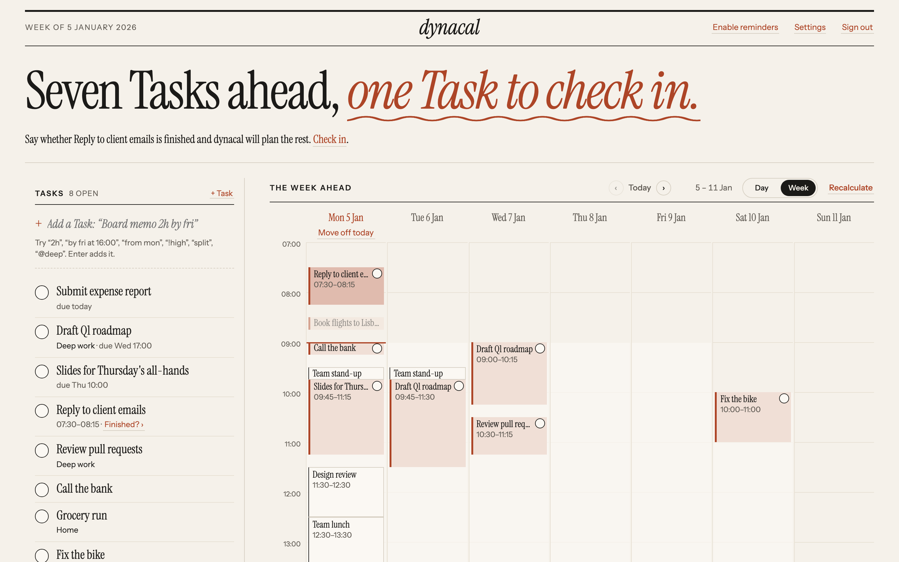
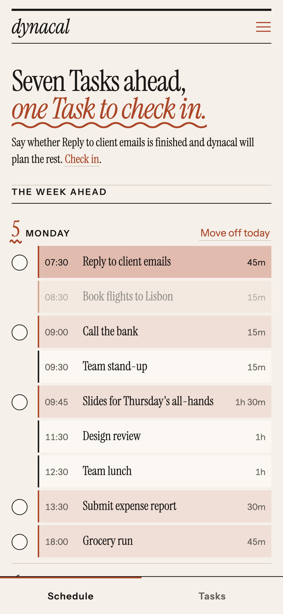
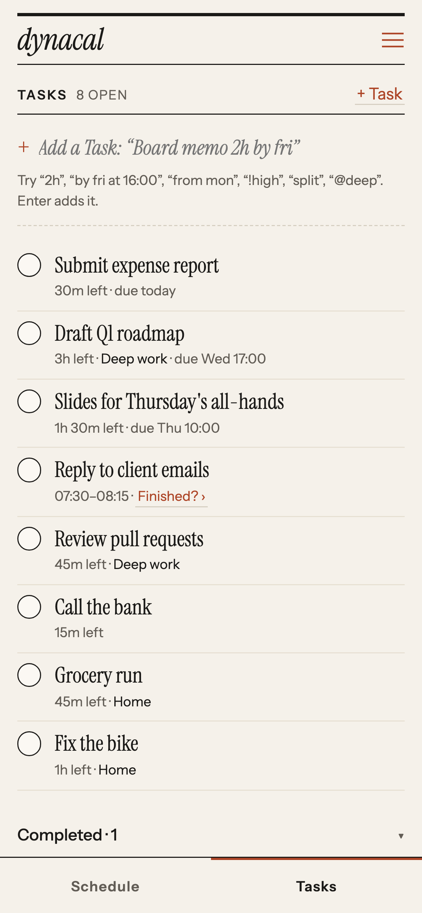
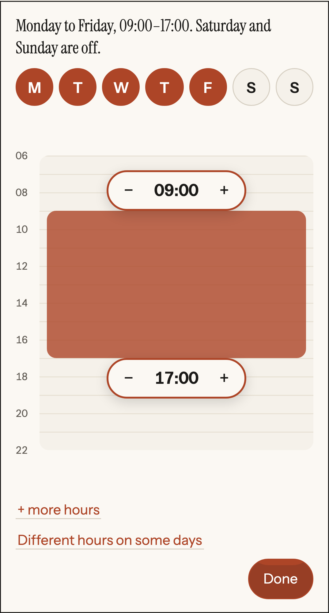

# dynacal

A self-hosted planner that turns your Tasks into a time-blocked Schedule around your Google Calendar.

<p align="center">
  
</p>
<p align="center">
  
  &nbsp;
  
  &nbsp;
  
</p>

## Features

- **Scheduling:** places each Task in free time before its deadline, earliest deadline first. When there isn't room for everything, the lower-Priority Task misses.
- **Google Calendar:** plans around your busy calendars without editing them, and writes Tasks to its own "dynacal" calendar. Changes you make in Google come back to dynacal.
- **Contexts:** named weekly hours, such as "Deep work, weekdays 08:00–11:00". Each Task is placed only inside its Context. To edit one, tap its days and drag a bar.
- **Quick entry:** type "Board memo 2h by fri !high @deep".
- **Moving Tasks:** drag a Task to pin it, send it to tomorrow, or use Move off today to clear the rest of the day. Undo puts things back.
- **Check-ins:** after a Task's time has passed, dynacal asks "Finished?" and plans the rest.
- **Reminders:** web push notifications before each Task starts.
- **Phone first:** add dynacal to your Home Screen. Once reminders are on, it opens offline and shows the last Schedule it saw.

## Run it

You need Docker, a Google OAuth client and a web push key pair. [docs/self-hosting.md](docs/self-hosting.md) explains how to get each one.

```bash
cp .env.example .env   # fill in all six values
docker build -t dynacal .
docker run -d --name dynacal --restart unless-stopped -p 3000:3000 --env-file .env -v dynacal-data:/data dynacal
```

Open `PUBLIC_BASE_URL`, sign in as `OWNER_EMAIL`, and follow the setup.

## Develop

Node 24 and pnpm.

```bash
pnpm install
pnpm dev     # http://localhost:3000
pnpm check   # types, unit tests and browser tests (browser tests need Docker and `pnpm exec playwright install chromium`)
```

`pnpm screenshots` retakes the images above.

[GLOSSARY.md](GLOSSARY.md) defines the domain terms, and [docs/adr/](docs/adr/) records the design decisions.

## License

[MIT](LICENSE)
